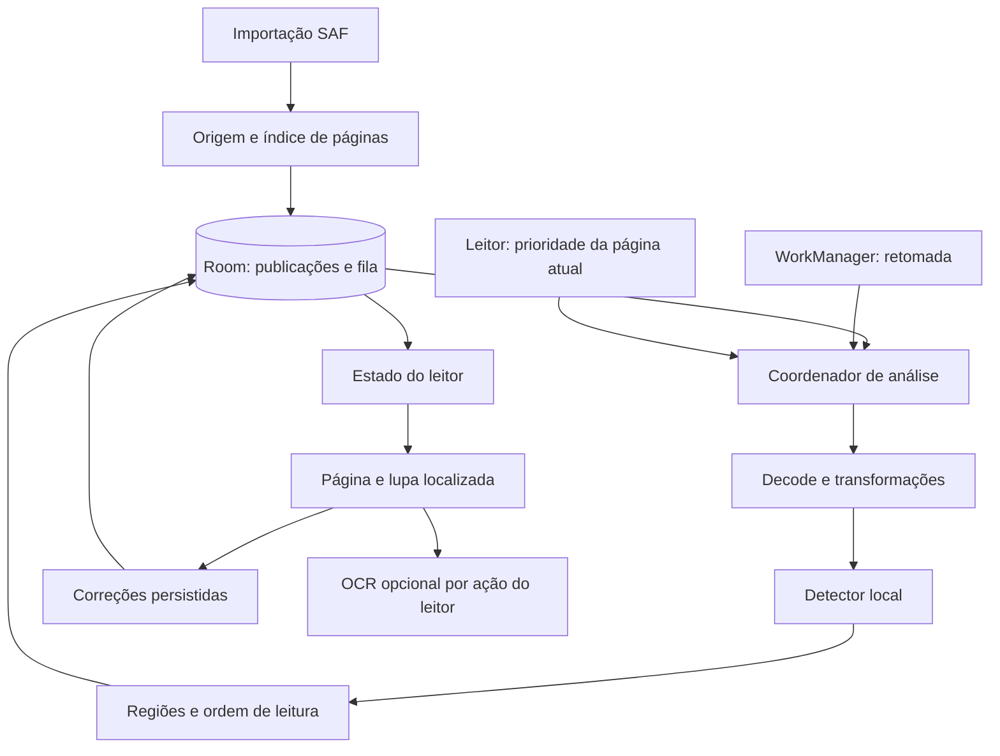

# Estante — plano executável de leitura automática de balões

Versão 1.1 · 1 de novembro de 2026 · Estado: primeira fatia experimental implementada; validação pendente

Este documento detalha a próxima entrega do Estante. Complementa o plano geral de implementação e prevalece sobre descrições anteriores de seleção e ampliação no fluxo de quadrinhos. Os parâmetros numéricos identificados como propostas precisam de validação; não representam resultados já obtidos.

## 1. Resultado esperado

Ao adicionar um quadrinho, o Estante identifica automaticamente os balões de suas páginas. Durante a leitura, o usuário percorre esses balões e recebe uma pequena ampliação localizada, suficiente para facilitar a leitura, mantendo a página como contexto visual.

O caminho habitual é:

**Adicionar quadrinho → análise automática → abrir leitura guiada → ver um balão levemente ampliado → avançar para o próximo → continuar na próxima página.**

A detecção dispensa seleção manual. A lupa amplia os pixels originais do balão; OCR fica disponível como recurso independente para extrair palavras. Não há necessidade de OCR para entrar no guia, ampliar ou avançar.

### Decisões de produto

| Tema | Comportamento definido |
| --- | --- |
| Momento da análise | Inicia automaticamente após a importação válida; inclui todas as páginas do novo quadrinho |
| Acesso à leitura | Disponível enquanto as demais páginas são analisadas; página visível recebe prioridade |
| Ampliação | Lupa sobre a página, com margem ao redor do balão; página de fundo mantém escala e posição |
| Intensidade | Moderada por padrão, ajustável pelo leitor e limitada à janela disponível |
| Ativação | Controle “Leitura guiada”; a preferência é lembrada por quadrinho |
| Primeiro uso | Biblioteca oferece “Ler com balões ampliados” quando a primeira página estiver analisada |
| Avanço | Toque em próximo/anterior ou em um balão detectado; sem avanço por tempo |
| Final de página | Próximo abre a página seguinte e foca seu primeiro balão disponível |
| Recuperação | Correção manual para região ausente, incorreta ou fora de ordem |
| Retomada | Salva documento, página, balão ativo, direção e preferência da lupa |
| Privacidade | Detecção, leitura e OCR funcionam no dispositivo; páginas não são enviadas a servidores |

### Escopo da primeira entrega

CBZ/ZIP, vários quadrinhos registrados localmente, detecção automática, processamento retomável, persistência de regiões, lupa, navegação LTR/RTL, progresso de leitura e correção básica. EPUB, PDF, CBR, tradução e voz continuam no plano geral e não bloqueiam essa entrega.

## 2. Situação real do repositório

Inspeção realizada nos arquivos atuais; esta revisão não executou testes nem medições de desempenho.

| Existe hoje | Como será aproveitado | Lacuna relevante |
| --- | --- | --- |
| Kotlin, Compose, Gradle Wrapper e catálogo de versões | Manter base de build | Validar novas dependências e integração contínua |
| `MainActivity.kt` com biblioteca e leitor | Preservar fluxo de abertura | Separar telas e substituir recorte em tela cheia pela lupa |
| `EstanteViewModel.kt` com DataStore e OCR | Migrar último documento/progresso | Acumula acesso a arquivos, imagens, OCR e estado; não sustenta vários livros ou fila durável |
| `CbzArchive` com limites e `ZipFile` | Reutilizar leitura aleatória | Controlar propriedade dos handles, validação e cache para leitura concorrente com análise |
| `NormalizedRect` e `GuidedRegion` | Reutilizar coordenadas normalizadas | Acrescentar identidade durável, versão de análise e vínculo com página |
| `RegionDetector<Page>` | Usar como ponto de partida | Implementar detector real, ciclo de vida e cancelamento cooperativo |
| Ordenação geométrica LTR/RTL | Baseline para comparação | Layout de painéis precisa entrar na avaliação |
| `RegionOverride` e `GuidedPage` | Evoluir modelo de correções | Inserção de regiões manuais não está completa; posições explícitas de ordem precisam respeitar seus índices, em vez de formar apenas um prefixo |
| Testes de arquivos e geometria | Estender com casos de regressão relevantes | Ainda não demonstram inferência real, lupa, retomada ou comportamento no Fold |

O cache atual mantém essencialmente o último arquivo e remove outros arquivos da pasta ao importar. Antes de analisar vários quadrinhos em segundo plano, isso deve ser substituído por uma política por documento, com proteção dos arquivos em uso. Resultados de análise não podem depender da sobrevivência desse cache.

O protótipo guarda bitmaps grandes no estado do ViewModel e usa identificadores de requisição para evitar parte dos resultados atrasados. A evolução deve separar recursos de imagem e estado durável, fechar recursos nativos e preservar a semântica de cancelamento das coroutines.

## 3. Jornadas e critérios observáveis

### 3.1 Importar

1. Usuário seleciona um arquivo pelo seletor Android.
2. App valida acesso, formato, limites e espaço disponível.
3. Registra publicação, origem e páginas; apresenta a capa quando disponível.
4. Agenda automaticamente a detecção, com progresso “Preparando balões · 12 de 80 páginas”.
5. Libera a leitura sem esperar a análise completa. A página solicitada passa à frente das páginas distantes.
6. Cada análise concluída fica salva imediatamente; pausar preserva tudo o que terminou.

**Aceitação:** nenhuma página exige acionar “detectar”; o andamento distingue páginas concluídas, pendentes e com erro. Um arquivo corrompido não gera estado falso de sucesso.

### 3.2 Ler

1. Abrir o quadrinho e ativar o guia, ou restaurar a preferência anterior.
2. Focar o balão salvo; na primeira leitura, focar o primeiro da sequência.
3. Mostrar lupa localizada e indicador discreto, como “Balão 2 de 7”.
4. Avançar/voltar altera somente o foco e a lupa, preservando a transformação da página.
5. Tocar em outro balão detectado permite saltar diretamente para ele.
6. Fechar a lupa revela a página na posição em que já estava.

**Aceitação:** importar → abrir → percorrer uma página funciona sem desenhar caixas e com OCR desligado. O balão ampliado preserva o texto original.

### 3.3 Página sem resultado pronto

| Situação | Resposta do app |
| --- | --- |
| Análise pendente | Exibe página, informa preparação e prioriza a tarefa; permite continuar navegando |
| Zero balões detectados | Trata como resultado válido; permite próxima página e adicionar região manual |
| Erro de análise | Exibe página e oferece tentar novamente ou corrigir manualmente |
| Análise pausada pelo usuário | Mantém a pausa; oferece “Analisar esta página” explicitamente |
| Modelo indisponível/incompatível | Leitura comum continua disponível, com estado de recurso indisponível |
| Arquivo sem acesso | Solicita vincular novamente, preservando progresso e correções |

**Aceitação:** a ausência de balões nunca prende o leitor nem aciona uma cadeia invisível de pulos de página.

### 3.4 Corrigir

O leitor pode adicionar uma região, ajustar seu retângulo, ignorá-la ou alterar a sequência. Correções ficam vinculadas à revisão da página e separadas das previsões do detector. Reprocessamento preserva as correções e sinaliza conflitos quando não for possível conciliá-las.

## 4. Especificação da lupa

### Composição visual

A lupa é uma camada Compose ancorada ao balão ativo. Mostra uma região da imagem original com margem, borda discreta e indicação da origem. Apenas uma lupa aparece por vez. Evitar escurecimento intenso da página, barras grandes e contornos de todas as detecções no modo normal; a visualização de caixas numeradas pertence ao modo de correção/diagnóstico.

**Parâmetros iniciais propostos para protótipo:** ampliação padrão de 1,4× em relação ao tamanho exibido na página; opções iniciais de 1,2×, 1,4× e 1,7×; margem de 8% do retângulo detectado. A definição final depende da legibilidade no Fold, especialmente na tela externa. Esses valores não garantem leitura de texto minúsculo.

### Posicionamento e casos extremos

1. Calcular o retângulo original do balão na janela usando a mesma transformação da página.
2. Expandir o conteúdo com margem, limitada aos limites da imagem.
3. Ampliar a região em torno do seu centro e deslocar a lupa para dentro da área segura da janela.
4. Respeitar barras, recortes, controles e áreas de dobradiça que separem a janela.
5. Manter a escala da página de fundo constante; abrir a lupa não reinicializa zoom/pan feito pelo usuário.

Como proposta inicial, limitar a janela da lupa a 70% da largura e 50% da altura úteis. Quando o conteúdo ampliado exceder esse espaço, permitir deslocamento dentro da lupa, com indicação de conteúdo adicional. Não reduzir silenciosamente a escala abaixo da solicitada nem cortar texto sem oferecer acesso à parte restante. Balões muito grandes podem ser lidos na página com um toque para dispensar a lupa. As proporções serão calibradas em telas compactas e expandidas.

Para texto muito pequeno, oferecer ajuste adicional de ampliação. Aumentar a lupa não exige alterar a página inteira. Preservar proporção da imagem, sem esticar o balão.

### Interação e acessibilidade

- Próximo/anterior têm alvos de pelo menos 48 dp e rótulos acessíveis; gestos são atalhos adicionais.
- Um toque simples em regiões sobrepostas deve usar uma regra determinística; oferecer seleção alternativa no modo de correção.
- Arrastar dentro da lupa desloca seu conteúdo quando necessário; arrastar a página mantém o comportamento normal fora dela.
- O botão Voltar fecha primeiro a lupa/modo de edição antes de sair do leitor.
- Transições propostas de 150–200 ms, canceláveis, sem animação quando movimento reduzido estiver ativado.
- TalkBack anuncia página e posição do balão. Texto OCR só é anunciado quando disponível e solicitado; não inventar descrição do desenho.
- Recalcular posição ao dobrar, girar ou redimensionar, preservando o identificador do balão ativo.

## 5. Arquitetura e limites de responsabilidade

Manter Kotlin/Compose, Activity única, ViewModel e StateFlow. Introduzir Room para publicações, análises, tarefas e progresso; reservar DataStore para preferências. Composables recebem estado e emitem ações. A coordenação de inferência vive fora das telas e não depende da Activity.

### Organização incremental

| Área planejada | Responsabilidade |
| --- | --- |
| `core/reader` | IDs, locators, regiões e geometria; sem dependência de UI ou runtime de ML |
| `core/data` | Room, repositórios, migrações, origem SAF e política de arquivos |
| `core/imaging` | Decode, cache de imagens, transformações e recortes em resolução adequada |
| `core/analysis` | Contratos de detector, coordenador e adaptação do runtime |
| `feature/library` | Importação, lista e andamento por quadrinho |
| `feature/reader` | Página, lupa, navegação e correções |
| `app` | Composição e injeção das dependências Android |

Essas fronteiras começam como pacotes quando isso permitir uma migração menor. Extrair módulos Gradle por fronteira já estável, sem transformar cada classe em módulo. Usar injeção por construtor; introduzir Hilt na composição de serviços/Workers, com versões verificadas contra a cadeia atual antes da integração.

### Contratos centrais

| Contrato | Entrada/saída e regra |
| --- | --- |
| `PageSource` | Identidade de publicação/página → recurso de leitura com fechamento definido |
| `PageImageRepository` | Página + resolução/região → imagem e metadados da transformação; cache limitado |
| `BubbleDetector` | Imagem preparada → regiões, classes, confiança opcional e metadados do modelo |
| `PageAnalysisRepository` | Buscar versão válida, adquirir tarefa e gravar análise atomicamente |
| `AnalysisCoordinator` | Enfileirar, priorizar, pausar, retomar e deduplicar solicitações |
| `ReadingOrderResolver` | Regiões, painéis quando disponíveis e direção → sequência estável |
| `LensLayoutResolver` | Região, transformação e área útil → posição, escala e limites da lupa |
| `ReaderProgressRepository` | Salvar/restaurar locator tipado por publicação |

Chamadas que bloqueiam ficam em dispatchers apropriados e injetáveis. A API do detector deve permitir liberar sessões/tensores; a implementação pode continuar síncrona internamente, exposta pelo coordenador em trabalho fora da thread principal.

## 6. Escolha e integração do detector

O primeiro candidato para avaliação é `ogkalu/comic-text-and-bubble-detector`. Sua ficha descreve classes `bubble`, `text_bubble` e `text_free`, e declara licença Apache-2.0. Isso o torna um candidato para avaliação, sem demonstrar ainda qualidade ou velocidade no Estante. [Ficha do modelo](https://huggingface.co/ogkalu/comic-text-and-bubble-detector)

ONNX Runtime possui integração Android. Começar com execução CPU e medir o modelo escolhido antes de experimentar aceleradores; suporte e desempenho dependem do artefato e do dispositivo. [Documentação móvel do ONNX Runtime](https://onnxruntime.ai/docs/tutorials/mobile/)

### Etapa obrigatória antes da integração definitiva

1. Identificar o artefato exato, revisão imutável, origem, tamanho, SHA-256 e licenças/avisos aplicáveis.
2. Inspecionar entradas e saídas reais: nomes, tipos, dimensões, escala, canais, normalização e coordenadas.
3. Executar páginas de referência e confirmar visualmente o significado de cada classe. Caixa de texto dentro do balão não deve ser tratada como contorno completo sem adaptação explícita.
4. Verificar se a saída já inclui seleção/supressão de duplicatas. Não aplicar NMS indiscriminadamente a um modelo que já forneça resultados finais.
5. Medir a variante reduzida/quantizada e, quando necessário, comparar com a variante de referência usando os mesmos exemplos.
6. Registrar decisão em `docs/adr/0001-detector-local.md`: qualidade, memória, tempo, tamanho adicionado ao APK, limitações e alternativa.

Não assumir que o preprocessing ou as classes de uma exportação são idênticos aos de outra. A versão de pipeline deve incluir também o mapeamento de classes e os parâmetros de filtragem.

### Distribuição proposta

Para a alpha, empacotar um modelo validado junto com o APK, com revisão e checksum fixos, licenças e avisos. Isso permite demonstrar o guia offline desde a primeira instalação. Caso tamanho ou distribuição inviabilizem essa opção, registrar decisão alternativa de download inicial com estado claro, retomada, integridade e instalação atômica. Não adicionar download obrigatório silencioso.

A atualização do modelo cria uma nova versão de análise. Manter resultados anteriores utilizáveis até a substituição validada; nunca apagar correções humanas apenas porque o detector mudou. Treinamento próprio entra somente se os modelos avaliados deixarem uma lacuna mensurável.

## 7. Pipeline de análise por página

1. **Verificar identidade:** publicação, revisão da origem, página e versão do pipeline.
2. **Consultar análise existente:** resultado válido encerra a solicitação sem executar inferência.
3. **Adquirir tarefa:** uma transação atribui a execução a um único consumidor.
4. **Decodificar:** validar dimensões e orientação; produzir entrada limitada ao orçamento de memória.
5. **Preparar imagem:** executar exatamente resize/letterbox/corte exigido pelo modelo; registrar a transformação inversa.
6. **Detectar:** executar inferência e descartar números inválidos, coordenadas degeneradas e classes sem suporte.
7. **Consolidar:** mapear regiões para coordenadas normalizadas da página; tratar duplicatas, classes e margens.
8. **Ordenar:** aplicar direção, contexto de painéis disponível e correções compatíveis.
9. **Persistir:** gravar regiões, sequência e estado final em uma única transação, validando que revisão e tarefa ainda são atuais.
10. **Liberar:** fechar tensores, descritores e imagens temporárias; notificar observadores e seguir à próxima tarefa.

Para páginas muito altas ou balões pequenos perdidos no redimensionamento, avaliar divisão em segmentos sobrepostos. Cada segmento precisa de transformação para a página inteira; detecções repetidas nas junções devem ser conciliadas. Só ativar essa estratégia após demonstrar benefício no corpus, pois aumenta o custo de processamento.

### Política de conteúdo

Balões de fala e pensamento entram no guia. Caixas narrativas entram quando identificadas como tal. Onomatopeias, logotipos e textos de cenário não entram indiscriminadamente. Se o detector não distingue essas categorias com qualidade suficiente, documentar a limitação e permitir inclusão/exclusão pelo leitor. Nunca eliminar caixas narrativas apenas porque estão fora de um balão.

## 8. Ordem de leitura

LTR e RTL são preferências por publicação, editáveis e independentes do idioma do OCR. Usar metadados válidos quando presentes; na ausência, mostrar o padrão escolhido e permitir alterá-lo facilmente.

A abordagem será progressiva:

1. Medir a ordenação geométrica já existente como baseline.
2. Quando houver estrutura de painéis confiável, ordenar os painéis e depois os balões de cada painel.
3. Associar regiões a painéis por regras de contenção/sobreposição; resolver empates de forma determinística e registrar os casos ambíguos para avaliação.
4. Em layouts sem painéis confiáveis, usar o baseline e manter correção manual acessível.
5. Aplicar a sequência corrigida pelo usuário sobre a inferência, preservando inclusão, exclusão e inserção em posições explícitas.

Detectar painéis pode exigir um componente adicional. A escolha entre geometria de margens e um segundo modelo depende dos erros encontrados. Não declarar a ordem resolvida apenas porque os retângulos foram ordenados por altura.

Persistir a versão do algoritmo de ordem. Mudar LTR/RTL recalcula a sequência sem repetir a detecção. Se houver ordem manual, preservar a escolha do leitor ou oferecer uma redefinição explícita, sem apagá-la automaticamente.

## 9. Dados, identidade e migrações

| Entidade | Campos e restrições principais |
| --- | --- |
| `Publication` | UUID, título, formato, data de importação, estado de disponibilidade |
| `DocumentSource` | Publicação, URI ou cópia gerenciada, metadados, revisão e fingerprint |
| `Page` | ID, publicação, índice, nome da entrada, dimensões/orientação, hash quando calculado; índice único por revisão |
| `AnalysisRun` | Publicação/revisão, modelo/hash, versões de preprocessing/filtragem/ordem, estado e contadores |
| `PageAnalysis` | Página + versão única, estado, tentativas, erro categorizado, duração e dono temporário da tarefa |
| `Region` | ID estável dentro da análise, página, bounds normalizados, classe, confiança e vínculo opcional com painel |
| `RegionCorrection` | Região de origem opcional, bounds/tipo corrigidos, exclusão/inserção, sequência e revisão da página |
| `ReadingProgress` | Publicação, página, região ativa, versão da sequência e timestamp |
| `ReaderPreferences` | Direção, guia ativo, intensidade da lupa e preferências visuais por publicação |

Banco guarda metadados e coordenadas; imagens, modelos e cópias de quadrinhos ficam em armazenamento próprio. Correções e progresso não são cache descartável.

### Identidade e invalidação

URI/nome de arquivo não provam que o conteúdo permaneceu igual. Registrar tamanho/modificação quando disponíveis e usar hash de conteúdo para estabelecer identidade confiável durante a cópia/indexação. CRC de ZIP pode ajudar na triagem, mas não substitui hash de conteúdo quando é necessária garantia contra mudança.

Chave de análise: revisão do conteúdo + identidade da página + hash do modelo + versão do preprocessing/filtragem. Ordem e correções têm versões próprias. Reutilizar detecção quando só a direção ou a posição visual da lupa mudou.

Se o arquivo mudar, preservar a publicação e marcar análises incompatíveis. Não reaplicar automaticamente correções em imagens diferentes. Se o balão salvo desaparecer após reanálise, restaurar a página e oferecer foco próximo apenas quando a correspondência for inequívoca.

### Migração do protótipo

Criar migração idempotente das chaves atuais de URI e índice para uma publicação no Room. Executá-la uma única vez, preservar o dado antigo até o novo registro estar confirmado e tratar URI revogada sem perder o progresso. Exportar schemas e proibir migração destrutiva em produção.

## 10. Fila durável e execução Android

O WorkManager agenda retomada e trabalho adiável; Room é a fonte de verdade das páginas pendentes. Usar trabalho único por publicação/revisão/pipeline para evitar agendamento duplicado. O mecanismo de trabalho único é documentado pelo Android. [Gerenciamento de trabalho](https://developer.android.com/develop/background-work/background-tasks/persistent/how-to/manage-work)

Não criar milhares de Workers independentes para um volume grande. Um Worker processa um lote limitado por tempo/páginas, grava checkpoints e agenda continuação quando necessário. O coordenador em primeiro plano e o Worker compartilham o mesmo mecanismo de aquisição de tarefas; a UI não executa uma segunda cópia da mesma inferência.

### Estados

| Estado | Significado | Próxima ação |
| --- | --- | --- |
| `QUEUED` | Aguardando análise | Adquirir tarefa quando permitido |
| `RUNNING` | Execução atribuída a um consumidor | Finalizar transação ou liberar/reagendar |
| `READY` | Resultado válido, inclusive zero regiões | Reutilizar |
| `RETRYABLE_ERROR` | Erro temporário | Repetição limitada com atraso |
| `FAILED` | Falha persistente ou arquivo inválido | Expor causa e recuperação manual |
| `STALE` | Conteúdo/modelo incompatível | Criar análise da nova versão |

Pausa/cancelamento são estados do processamento da publicação. Uma pausa não transforma resultados prontos em pendentes. Tarefas `RUNNING` usam uma concessão temporária renovável; após morte do processo, concessões expiradas voltam à fila. A gravação valida o identificador da execução para impedir que um resultado antigo sobrescreva uma execução nova.

### Prioridade e limites

- Prioridade: página visível → próximas duas páginas → restante do quadrinho → outras publicações.
- Começar com uma inferência ativa no processo e pré-carregamento limitado; aumentar concorrência só com evidência de benefício.
- Evitar fome de tarefas antigas com alternância entre publicações/lotes quando o leitor estiver ocioso.
- Trocar de página cancela a assinatura visual e atualiza prioridade. Se a inferência nativa não puder ser interrompida, seu resultado pode ser salvo para a página correta, sem aparecer na tela errada.
- Pausar impede novas tarefas; a tarefa atual termina ou cancela conforme o runtime permitir. A interface informa esse estado.
- Erros transitórios recebem no máximo três tentativas automáticas inicialmente; erros de formato/modelo incompatível exigem ação, sem repetição infinita.
- Economia de bateria/temperatura elevada reduz ou pausa trabalho distante da página visível. Falta de espaço bloqueia cópias novas com recuperação clara.

O sistema pode adiar processamento de fundo. Após encerramento forçado pelo usuário, a retomada deve ocorrer quando o app for novamente aberto e reconciliar sua fila; não prometer execução durante force-stop. Uma futura necessidade de serviço em primeiro plano deve ser avaliada contra as restrições da versão Android alvo, sem presumir que ele garante execução ilimitada.

## 11. Arquivos, imagens e memória

### Origem e cópia

Preservar SAF e permissão persistida quando suportada. Provedores sem acesso aleatório exigem cópia limitada. A política deve identificar cada arquivo por documento/revisão, proteger arquivos em uso e limpar apenas cache reconstruível sem tarefas ativas. Uma cópia gerenciada escolhida pelo usuário é dado persistente e não deve ser apagada como cache.

O limite atual de 512 MiB para arquivo compactado será preservado inicialmente e mostrado no erro de importação. Limites de bytes descompactados, entradas e dimensões continuam ativos. O indexador atual percorre conteúdo para validar limites; esse custo deve aparecer separado do tempo de detecção no benchmark.

### Imagens

Usar uma imagem reduzida para inferência e uma representação adequada ao tamanho exibido para página/lupa. Coordenadas sempre referem-se à página orientada original. Para páginas gigantes, avaliar region decoding/tiles; validar o suporte por formato antes de assumir que um recorte pode ser decodificado isoladamente.

O repositório de imagens define propriedade e vida útil dos buffers. Não reciclar um bitmap enquanto Compose, OCR ou inferência ainda o utiliza. Liberar recursos por referências explícitas e blocos `finally`, incluindo erros e cancelamentos. O ViewModel mantém IDs e estado de apresentação, sem ser o proprietário de grandes caches de imagem.

Orçamento inicial proposto para cache de imagens: menor valor entre 64 MiB e 20% do heap disponível. Isso exclui memória nativa do runtime e não constitui um limite total de RAM. Medir PSS/heap e ajustar resolução/concorrência para evitar OOM.

## 12. Plano de qualidade e avaliação

### Corpus

Montar um conjunto inicial de aproximadamente 100 páginas, de pelo menos 10 obras autorizadas ou redistribuíveis. Incluir HQ colorida em português, manga em preto e branco, layouts irregulares, balões unidos, narração, texto pequeno, páginas vazias e páginas altas. Registrar origem, direito de uso e estilo.

Separar por obra, como proposta inicial 60% para desenvolvimento, 20% para ajustes e 20% para avaliação congelada. Não ajustar limiares usando o conjunto final. Para avaliar ordem, anotar sequência completa e situações ambíguas, com revisão humana.

Esse conjunto permite detectar problemas iniciais; não sustenta uma promessa de acerto universal. Reportar também por estilo e obra para não esconder um grupo ruim na média.

### Metas propostas

| Métrica | Meta inicial | Como medir |
| --- | --- | --- |
| Detecção | Recall ≥95% e precisão ≥90% | Correspondência um a um com IoU ≥0,5; duplicatas contam como falsos positivos |
| Ordem | ≥90% de pares consecutivos corretos | Mesmo conjunto anotado; reportar também páginas inteiramente corretas |
| Cobertura visual | Texto completo acessível em toda lupa aprovada | Revisão de bordas, margens, balões unidos e janela compacta |
| Análise por página no Fold 6 | p95 ≤2 s | Decode/preprocessing/inferência/persistência discriminados; cold start separado |
| Foco em região com imagem pronta | p95 ≤100 ms até início da resposta visual | Instrumentação de interação; animação medida separadamente |
| Fluidez | <5% de frames lentos no percurso de referência | Frame timing em build release, 60/120 Hz quando disponíveis |
| Retomada | Nenhuma perda de resultado já confirmado em banco | Matar processo em pontos controlados e reabrir |
| Robustez | Sem crash, ANR ou OOM no conjunto de aceitação | Sessões longas, importações concorrentes e pressão de memória |

Medir lote completo de quadrinho e tempo até primeira página utilizável, incluindo cópia/validação. A meta de 2 s por página não é uma promessa de importação de qualquer arquivo em 2 s. Registrar tamanho, resolução, compressão, temperatura e estado de energia. Executar ao menos 30 medições por cenário de latência após aquecimento, com execuções frias separadas; não extrapolar do emulador para o Fold.

Se a qualidade ficar abaixo das metas, o modo pode circular em alpha explicitamente experimental para coleta de problemas. Isso não autoriza anunciá-lo como confiável. A entrega funcional continua exigindo detecção real, persistência e lupa; seleção manual isolada não atende o marco.

### Matriz de testes

| Nível | Casos necessários |
| --- | --- |
| Unitários | Transformações ida/volta, orientação, limites, posicionamento da lupa, ordem LTR/RTL, inserção de correções, invalidação |
| Integração de dados | Migrações, transações, tarefa única, concessão expirada, revisão modificada, progresso por publicação |
| Integração do modelo | Artefato real, entradas/saídas, classes, ausência de NaN, imagens de referência e fechamento de tensores |
| Interface | Importar → guia → próximo → última região → próxima página → fechar lupa; OCR desligado; nenhuma seleção manual |
| Recuperação | Permissão revogada, arquivo removido, cache limpo, falta de espaço, cancelamento e resultado atrasado |
| Lifecycle | Rotação, dobrar/desdobrar, redimensionamento, Activity recriada e morte real do processo |
| Acessibilidade | TalkBack, fonte ampliada, alvos de toque, controles alternativos, movimento reduzido |
| Distribuição | APK release, instalação limpa offline, atualização preservando dados, ABIs e compatibilidade nativa com páginas de memória de 16 KB |

Matriz de dispositivos: SDK mínimo declarado, versão intermediária, API alvo, telefone compacto, tablet/emulador dobrável e Fold 6 real nas duas telas e em multiwindow. Caso uma dependência eleve o SDK mínimo, registrar a mudança antes de atualizar a configuração.

## 13. Etapas de implementação e critérios de saída

| ID | Entrega concreta | Dependências | Critério de conclusão |
| --- | --- | --- | --- |
| A00 | Baseline e roteiro de referência | — | Estado atual registrado, build reproduzível e cenários de aceitação definidos |
| A01 | Corpus e escolha inicial do detector | A00 | Anotações, artefato fixado, relatório inicial e decisão de runtime |
| A02 | Repositórios, Room e migração | A00 | Vários quadrinhos/progressos persistidos; migração do último arquivo e cache por documento |
| A03 | Geometria e lupa localizada | A00 | Lupa com regiões sintéticas, bordas, limites e página estável; não depende do modelo |
| A04 | Adaptador de inferência real | A01 | Página real → regiões normalizadas corretas; recursos fechados e tempos registrados |
| A05 | Fila automática retomável | A02, A04 | Importar agenda todas as páginas; pausa/retomada, prioridade e deduplicação comprovadas |
| A06 | Ordem e correções | A01, A02, A04 | LTR/RTL, avaliação por layout e edições persistidas; inserção manual funcional |
| A07 | Leitura guiada integrada | A03, A05, A06 | Fluxo completo sem seleção manual, OCR desligado, próxima página e retomada do balão |
| A08 | Fold, acessibilidade e desempenho | A07 | Matriz executada, medições release e defeitos críticos corrigidos |
| A09 | Empacotamento e alpha | A08 | APK verificável, documentação fiel, licenças/avisos, checksum e limitações conhecidas |

### Trabalho que pode avançar em paralelo

- Dados/importação: A02.
- UI/geometria da lupa: A03, usando regiões de fixture claramente identificadas.
- Modelo/corpus: A01 e depois A04.

Antes da divisão, estabilizar IDs de publicação/página, coordenadas, estados de análise e contrato de resultados. A integração A05–A07 deve usar esses contratos e mudanças pequenas por etapa, evitando três representações incompatíveis de região.

Cada etapa gera código revisável, evidência de aceitação e atualização deste plano. Tamanhos relativos: A00 pequeno; A02/A03 médios; A01/A04/A05/A06 grandes e sujeitos aos resultados do corpus; A07/A08 grandes; A09 pequeno a médio. Datas só serão estimadas após medir integração e qualidade do detector; o tempo de geração de código não determina o prazo de validação.

## 14. Mapa de mudanças no repositório

Os caminhos novos abaixo são planejados; não indicam arquivos já implementados.

| Local | Mudança prevista |
| --- | --- |
| `MainActivity.kt` | Manter composição e ponto de entrada; mover biblioteca/leitor para features |
| `EstanteViewModel.kt` | Dividir responsabilidades; delegar arquivos, imagens e análise; corrigir cancelamento e posse dos recursos |
| `core/archive/CbzArchive.kt` | Formalizar ownership, concorrência, limites e métricas de indexação |
| `core/guided/GuidedReading.kt` | Evoluir ordem, IDs/versionamento e correções, mantendo geometria pura reutilizável |
| `core/data/` | Entidades/DAOs, migrações, fontes e repositórios |
| `core/analysis/` | Detector real, coordenador, persistência de estado e Workers |
| `core/imaging/` | Cache, decode, mapeamento de coordenadas e recortes |
| `feature/reader/` | Tela, camada da lupa, navegação e edição |
| `feature/library/` | Lista de publicações, importação e progresso |
| `assets/models/` e avisos | Artefato validado e atribuições quando a distribuição empacotada for adotada |
| `docs/adr/` e `docs/benchmarks/` | Decisões e evidências por versão |
| Catálogo Gradle/Manifest | Dependências fixadas e permissões estritamente necessárias |
| CI | Build, lint, testes de lógica/dados e fluxo Android essencial |

## 15. CI, distribuição e operação

Em cada PR, compilar, executar lint e os testes pertinentes ao componente modificado. Alterações de banco exigem migrações verificadas; alterações de modelo/preprocessing exigem avaliação de regressão. Fixtures devem ser pequenas e redistribuíveis, com dados privados fora dos artefatos públicos.

Fixar versões e revisar compatibilidade do runtime nativo, AGP/Kotlin e SDK. Verificar checksum do modelo no preparo do artefato; falha de integridade impede carregamento. CI gera APK de teste e relatórios sem chaves de produção. A release usa assinatura guardada fora do repositório e inclui avisos das dependências e pesos.

Não registrar páginas, texto OCR ou URIs privadas nos logs. Diagnóstico local usa IDs, códigos de falha, tempos e versão do pipeline. Exportação de diagnóstico é uma ação explícita com revisão do conteúdo. Backup Android deve distinguir dados duráveis de cache/modelos e reconhecer que permissões SAF não se tornam válidas em outro aparelho apenas por restaurar o banco.

Se um modelo novo regredir, selecionar a última versão validada e sua análise compatível. Se não houver versão utilizável, manter leitura comum e correções manuais. A biblioteca e o progresso permanecem recuperáveis.

## 16. Riscos e decisões pendentes

| Risco | Mitigação e evidência necessária | Etapa |
| --- | --- | --- |
| Detector encontra texto, mas não o balão inteiro | Inspecionar semântica real e caixas; avaliar margem/segundo estágio com corpus | A01/A04 |
| Modelo adequado para manga falha em HQ colorida | Reportar métricas por estilo; avaliar candidato alternativo antes de treinamento próprio | A01/A04 |
| Lupa moderada não basta para texto pequeno | Calibrar presets e limites no Fold, com ajuste acessível pelo leitor | A03/A08 |
| Lupa encobre contexto demais | Medir área ocupada e posicionamento; preservar página e permitir dispensar instantaneamente | A03/A08 |
| Ordem falha em layouts complexos | Painéis, métricas de sequência e correção persistida | A06 |
| Fila duplica inferências ou perde resultados | Aquisição transacional, versão/identificador de execução e checkpoints | A05 |
| Cache apaga arquivo de análise ativa | Referências por documento e proteção de recursos em uso | A02/A05 |
| Android interrompe trabalho prolongado | Lotes pequenos, retomada e estados honestos; leitura atual prioritária | A05 |
| Consumo alto de memória/energia | Uma inferência por vez inicialmente, decode limitado e métricas em hardware real | A04/A08 |
| Licença ou procedência incompleta do artefato | Verificar código/peso/revisão e registrar avisos; escolher alternativa se necessário | A01/A09 |
| Importação lenta antes da inferência | Medir cópia/indexação separadamente e otimizar sem remover limites de segurança | A02/A08 |

Decisões abertas com responsável técnico: artefato do detector e runtime (A01); presets finais da lupa (A03/A08); método de painéis (A06); política final de cópia gerenciada/cache (A02); licença do projeto e assinatura de distribuição (A09). Escolhas técnicas reversíveis seguem o resultado medido. Alterações que mudem a experiência definida pelo usuário precisam ser apresentadas com um exemplo concreto.

## 17. Roteiro de aprovação da alpha

1. Instalar o APK em estado limpo e abrir sem conexão de rede.
2. Importar dois CBZs de referência e observar a análise iniciar automaticamente em ambos.
3. Abrir um deles antes de a análise integral terminar; confirmar prioridade da página visível.
4. Ativar guia, percorrer balões com ampliação moderada e verificar que a página não muda de escala.
5. Testar balões nas quatro bordas, um balão grande, uma página sem detecções e uma página com erro recuperável.
6. Alterar LTR/RTL, corrigir uma região e uma posição na sequência; fechar e reabrir.
7. Interromper o processo durante a análise; reabrir e confirmar que resultados concluídos e progresso persistiram.
8. Pausar um quadrinho, ler outro e retomar o primeiro sem tarefas duplicadas.
9. Dobrar/desdobrar o Fold, girar e entrar em janela dividida durante a lupa; manter região ativa e controles acessíveis.
10. Confirmar que todo o roteiro funciona com OCR desligado; depois acionar OCR como fluxo adicional.

**Concluído** significa: fluxo automático demonstrado, dados duráveis, lupa localizada, estados de falha recuperáveis, testes pertinentes aprovados e evidências de desempenho/qualidade registradas. Compilar ou abrir o app, isoladamente, não comprova essa entrega.

## 18. Acompanhamento

Após cada etapa, registrar: estado, arquivos/PRs, critérios atendidos, evidências, limitações e próximo bloqueio real. Estados permitidos: pendente, em execução, em validação e concluído. Não marcar uma etapa concluída com base apenas em interfaces, mocks ou resultados sintéticos quando sua aceitação exigir inferência real.

Estado após a primeira implementação (1 de novembro de 2026): há código real para o detector ONNX, persistência por página, análise sequencial com prioridade local, lupa sobre a página e controles LTR/RTL. Isso demonstra a direção técnica, mas não satisfaz ainda a conclusão A00–A09 definida acima: não houve inferência validada com um corpus de CBZ, medições no Fold 6, testes de recuperação do processo nem aceitação de ponta a ponta.

| Etapa | Estado | Evidência ou pendência |
| --- | --- | --- |
| A00 | Parcial | Build debug por ABI concluído; corpus e roteiro executado ainda pendentes |
| A01 | Parcial | Modelo ONNX, revisão, checksum e avisos integrados; comparação/anotações de corpus pendentes |
| A02 | Parcial | Room, estante de vários títulos, cópias gerenciadas e migração legada integrados; busca, filtros e recuperação de importação interrompida pendentes |
| A03 | Parcial | Lupa e navegação visual integradas; calibração de bordas, Fold e acessibilidade pendentes |
| A04 | Parcial | Adaptador de inferência real compila; inferência em CBZ, caixas resultantes e tempos ainda não verificados |
| A05 | Parcial | Job do ViewModel analisa páginas automaticamente e prioriza página atual/próximas; fila durável, pausa e retomada de processo pendentes |
| A06 | Parcial | Ordenação geométrica e alternância LTR/RTL disponíveis; métricas por layout e correções persistentes pendentes |
| A07 | Parcial | Estante de capas e leitor imersivo estão conectados; fluxo automático e toque em balões ainda sem validação com corpus real |
| A08 | Pendente | Fold 6, acessibilidade, desempenho e consumo sem medições |
| A09 | Parcial | APKs debug separados por ABI, licença do detector e aviso UnRAR presentes; validação release, distribuição e revisão final pendentes |

Não declarar a alpha concluída até executar os critérios da seção 17 com páginas autorizadas e registrar evidências. A implementação atual é experimental e deve ser avaliada antes de confiar na sequência automática.
